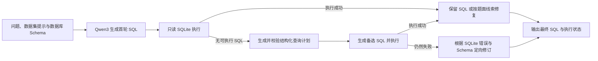

# Qwen3 Text-to-SQL Agent

在本地运行 Qwen3-4B，把自然语言问题转成只读 SQLite 查询。首轮 SQL 无法执行时，系统尝试结构化查询计划，再利用 SQLite 报错定向修订。项目还提供一个独立的销售数据演示，展示 Agent 如何在追问中继承时间范围、追加或替换地区条件。

在 BIRD Mini-Dev SQLite 的 313 题测试子集上，固定首轮 SQL 后加入回退和修复，**执行准确率从 46.65% 提升到 50.16%（+3.51 个百分点）**，SQL 可执行率从 **88.82% 提升到 98.08%**，平均每题增加 **0.44 秒**。

## 工作流程



修订候选需要通过只读执行和相应的结构检查。选择候选时只使用题面、Schema、候选 SQL 和执行反馈。BIRD 标准 SQL 由评测器单独使用。

## 评测结果

使用旧版 BIRD Mini-Dev SQLite，从 500 题中留出 22 题用于冒烟。其余 478 题分为 55 题策略诊断、110 题验证和 313 题冻结策略后的测试。四组题号互不重叠。313 题曾用于更早期的基线评测。**EX** 指预测和参考 SQL 均执行成功且结果集合相同的比例。SQL 可执行率只统计预测能否执行。[BIRD Mini-Dev](https://github.com/bird-bench/mini_dev)

| 题单 | 原始直出基线 | 首轮 SQL（A2） | 加结构化回退 | 加定向修复 |
| --- | ---: | ---: | ---: | ---: |
| 22 题冒烟 | 12/22 | 12/22 | — | — |
| 55 题诊断 | 24/55 | 24/55 | 26/55 | **29/55** |
| 110 题验证 | 44/110 | 46/110 | 48/110 | **52/110** |
| 313 题测试 | 139/313 | 146/313 | 153/313 | **157/313** |

- **策略取舍**。在 55 题上，对每道题都先生成结构化计划只答对 19 题。把计划限制在首轮执行失败时启用，答对 26 题。
- **逐题收益**。313 题对照中，回退修对 7 题，报错修订再修对 3 题，精度修复再修对 1 题。没有原本正确的首轮 SQL 在最终结果中变错。模型请求从 313 次增至 387 次。
- **剩余问题**。313 题中仍有 149 道预测 SQL 能执行但结果与参考不一致，另有 1 道参考 SQL 超时并计入固定分母。正式 EX 评测覆盖单轮任务，多轮追问以合成数据演示。

## 快速开始

在仓库根目录打开 PowerShell。实测环境为 Windows、Python 3.12、RTX 4060 Laptop GPU（8 GB）和 llama.cpp `b10343`。Python 客户端只使用标准库。

### 1. 启动本地模型

从 llama.cpp `b10343` 发布页下载 Windows x64 CUDA 12 推理包及配套的 CUDA 12.4 DLL 包，解压到 `.local/llama.cpp/b10343/`，让 DLL 和 `llama-server.exe` 位于同一目录。将 `Qwen3-4B-Instruct-2507-Q4_K_M.gguf` 放到 `.local/downloads/`。下面的 GGUF 文件与实验记录中的 SHA-256 一致。[llama.cpp b10343](https://github.com/ggml-org/llama.cpp/releases/tag/b10343) · [Qwen3-4B-Instruct-2507 模型](https://huggingface.co/Qwen/Qwen3-4B-Instruct-2507) · [Unsloth Q4_K_M 文件](https://huggingface.co/unsloth/Qwen3-4B-Instruct-2507-GGUF/blob/1e1094e82febb22ad75c2802fc1cbc94c74f8481/Qwen3-4B-Instruct-2507-Q4_K_M.gguf)

```powershell
& .\.local\llama.cpp\b10343\llama-server.exe -m .\.local\downloads\Qwen3-4B-Instruct-2507-Q4_K_M.gguf --alias qwen3-local --jinja -ngl 99 -c 4096 -np 1 --host 127.0.0.1 --port 8080
```

### 2. 运行多轮原型演示（可选）

> [!NOTE]
> **多轮追问仅在独立原型中实现。** 合成销售库的两轮用例验证了时间范围的继承和地区条件的追加或替换。最终 A2 流程及 BIRD 正式评测均只覆盖单轮 SQL 生成与执行反馈纠错。

保持模型服务运行，在第二个 PowerShell 终端执行。数据库由脚本从合成样本生成，不需要下载 BIRD。

```powershell
if (-not (Test-Path -LiteralPath 'data/sample_db/sales.sqlite')) {
    python -B -X utf8 scripts/build_demo_db.py
}
python -B -X utf8 scripts/smoke_multiturn.py --case add-region
```

第一问「2026 年第二季度共有多少笔订单？」的预期结果是 **3 笔**。第二问「只看华东呢？」应保留季度条件并追加地区条件，预期结果是 **2 笔**。演示脚本同时校验 SQLite 查询结果和模型回答。

### 3. 复现 BIRD 评测

下载旧版 SQLite `minidev.zip`，将解压后的 `minidev/MINIDEV/` 内容放入 `data/bird_mini_dev/`。确认 `mini_dev_sqlite.json`、`mini_dev_sqlite_gold.sql`、`dev_tables.json` 和 `dev_databases/` 都直接位于该目录下。[BIRD 维护者提供的旧版下载入口](https://github.com/bird-bench/mini_dev/issues/1)

可用 `Get-FileHash` 核对实验所用文件版本。

| 文件 | SHA-256 |
| --- | --- |
| `mini_dev_sqlite.json` | `4ba5fa8de55856222f484d380d2ba872b380bf79d825de70478e2120cb0fc43b` |
| `mini_dev_sqlite_gold.sql` | `6fb891aa8e1d948499de3295a24dd18d783d7ac04971908cbe2533436901af81` |

在模型服务运行时，按评测规模选择命令。

```powershell
# 单题冒烟
python -B -X utf8 scripts/run_bird_v2.py --mode A2 --limit 1

# 110 题验证
python -B -X utf8 scripts/run_bird_semantic_feedback.py --confirm

# 313 题配对评测
python -B -X utf8 scripts/run_bird_semantic_feedback.py --remaining
```

评测使用温度 `0`、种子 `42`。每次运行在 `.local/logs/` 下创建配置、汇总和逐题 JSONL。313 题记录中，`direct`、`baseline`、`chosen` 对应首轮 SQL、结构化回退后的结果和最终结果。表中成绩来自历史实测，当前入口可在相同题单上发起新一轮评测。

### 离线测试

下面的流程测试使用临时数据库和模拟响应，可直接运行。准备好 BIRD 数据后，还可以运行评分自检。

```powershell
python -B -X utf8 scripts/smoke_bird_v2.py
python -B -X utf8 scripts/smoke_bird_ex.py
```

## 代码入口

| 文件 | 用途 |
| --- | --- |
| [`run_bird_v2.py`](scripts/run_bird_v2.py) | 首轮 SQL 生成、结构化回退和实验调度 |
| [`run_bird_semantic_feedback.py`](scripts/run_bird_semantic_feedback.py) | 定向修复与逐题配对评测 |
| [`bird_v2_tools.py`](scripts/bird_v2_tools.py) | SQLite Schema、查询计划校验与错误诊断 |
| [`bird_ex.py`](scripts/bird_ex.py) | 只读 SQL 执行、超时控制与 EX 判分 |
| [`smoke_multiturn.py`](scripts/smoke_multiturn.py) | 销售数据的两轮追问演示 |

## 许可证

本仓库的项目代码采用 [MIT 许可证](LICENSE)。模型权重、推理器和 BIRD 数据由各自的上游项目提供，适用各自的许可条款。
